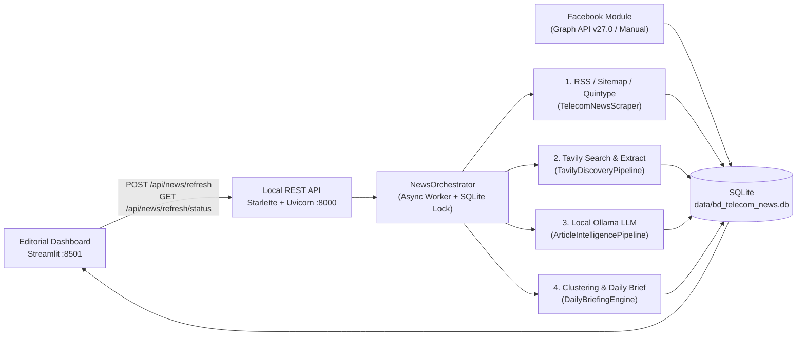

# Bangladesh Telecom Intelligence

A local-first, bilingual (**Bangla & English**) telecommunications intelligence platform for monitoring, analyzing, and briefing on Bangladesh's telecom ecosystem (**Grameenphone**, **Robi**, **Banglalink**, **Teletalk**, **BTCL**, **BSCCL**, **BTRC**, **AMTOB**, **ISPAB**, **VEON**, **Telenor**, **Axiata**, **Starlink**, tower/fiber providers, and MFS players).

Built to run **100% locally on consumer hardware** (tested on an 8 GB MacBook Air M1) with **zero paid LLM APIs**, strict publisher compliance, Pydantic-validated structured AI output, and an editorial intelligence dashboard.

---

## Problem Statement & Motivation

Telecom executives, regulatory teams, and analysts in Bangladesh monitor developments fragmented across dozens of English and Bangla news portals, international trade press, and corporate announcements. Manual monitoring suffers from:
- **Bilingual fragmentation:** Major regulatory and operator announcements break in Bangla on outlets like Prothom Alo and Ittefaq, and in English on The Daily Star, The Business Standard, Dhaka Tribune, and New Age.
- **Wire-service duplication:** Identical BSS/UNB press releases are republished across multiple portals, obscuring genuine industry signals.
- **Unstructured noise:** Raw headlines lack standardized entity tags, factual vs. speculative separation, and executive-ready daily summaries.

**Bangladesh Telecom Intelligence** automates compliant discovery, deduplication, local LLM structuring, Bangla–English event clustering, and executive briefing synthesis behind a single **Fetch Latest News** dashboard button.

---

## Key Features (Implemented)

- **Compliance-First Multi-Source News Scraper (`bd_telecom_scraper/`):** Covers 18 configured Bangladeshi portal editions using official Quintype Search & Collections JSON APIs, live RSS feeds, XML sitemaps (daily, monthly, half-year, Google News), and permitted HTML fallbacks. Enforces `robots.txt`, per-domain rate limits, and non-bypass `HTTP 403` handling.
- **Tavily Search & Extract Fallback (`bd_telecom_scraper/tavily/`):** Runs 6 semantic Bangladesh & global telecom queries with credible domain filtering (`include_domains`), skips already-collected URLs prior to fetching, invokes `POST /extract` only when primary HTML extraction fails, and enforces configurable monthly free-tier credit caps (`800/1,000` default) and per-query cooldowns.
- **Compliant Facebook Page Module (`bd_telecom_scraper/facebook/`):** Verified 24-Page telecom registry supporting Meta Graph API `v27.0` (for managed or PPCA-approved Pages) and Manual Public Content Ingestion (CLI single-post + JSON/CSV batch), unified with news articles via the `unified_telecom_intel` SQL view.
- **Local-Only Ollama Intelligence Engine (`bd_telecom_scraper/llm/`):** Uses local Ollama (`qwen2.5:3b` default, benchmarked against `gemma3:1b` on 8 GB M1) with strict Pydantic v2 JSON validation, deterministic bilingual entity fusion, explicit separation of **Reported Facts** vs. **AI Interpretation**, incremental `content_hash` change detection, failure isolation, and retries.
- **Daily Executive Briefing Engine (`bd_telecom_scraper/llm/briefing.py`):** Clusters multi-outlet Bangla and English coverage of the same event, prioritizes by industry impact and telecom relevance, sanitizes supporting article IDs against SQLite, and caches briefings by source fingerprint.
- **One-Click Orchestrator & Local REST API (`orchestrator.py`, `api/server.py`):** Local Starlette + Uvicorn API (`127.0.0.1:8000`) with `POST /api/news/refresh`, `GET /api/news/refresh/status`, and `GET /api/health`, single-runner concurrency locking (`409 Conflict` on duplicate runs), per-stage retries, and partial-failure isolation.
- **4-Section Premium Editorial Dashboard (`dashboard/`):** Warm-ivory, serif-headline Streamlit UI inspired by financial editorial publications—featuring **Editorial Masthead** (+ one-click **Fetch Latest News** & live `@st.fragment` progress strip), **The Daily Brief**, **Lead Story + Filtered Intelligence Feed**, **Industry Signals** (7-day vs. prior 7-day momentum), and a collapsible System & Operations sidebar.

---

## Architecture Overview



See [docs/ARCHITECTURE.md](docs/ARCHITECTURE.md) and [docs/TECHNICAL_DOCUMENTATION.md](docs/TECHNICAL_DOCUMENTATION.md) for module-level details and database schemas.

---

## Technology Stack

| Layer | Technologies |
| :--- | :--- |
| **Language & Runtime** | Python 3.11+ (tested on 3.13) |
| **HTTP & Parsing** | `httpx`, `feedparser`, `beautifulsoup4`, `lxml`, `trafilatura` |
| **Local LLM & Validation** | Local `ollama` (`qwen2.5:3b` default), `pydantic` v2 |
| **External Discovery (Optional)** | Tavily REST API (`/search`, `/extract`), Meta Graph API `v27.0` |
| **Storage** | SQLite 3 (11 tables + 1 unified view, zero external DB server) |
| **Backend API** | `starlette`, `uvicorn` (loopback `127.0.0.1` only) |
| **Frontend Dashboard** | `streamlit` with custom editorial CSS |
| **Monitoring & Testing** | `psutil`, `pytest`, GitHub Actions CI |

---

## Data Collection & Processing Workflow

1. **Portal Discovery:** Compliant `robots.txt`-checked crawling across Quintype JSON APIs, live RSS feeds, 14-day XML sitemaps, and permitted HTML sections.
2. **Tavily Discovery & Fallback:** Semantic news search across credible Bangladeshi & global telecom domains; URLs already in SQLite are skipped immediately; `POST /extract` runs only if free HTML extraction fails.
3. **Normalization & Deduplication:** URL canonicalization (`utm_*`, `fbclid`, `m.` stripped), `Asia/Dhaka` (`+06:00`) timestamp normalization, content hashing, and fuzzy headline matching for syndicated wire stories.
4. **Bilingual Filtering & Entity Tagging:** Weighted English + Bangla telecom lexicon across operators, BTRC/regulation, 2G–6G/RAN/infrastructure, vendors, broadband, and MFS.
5. **Local LLM Structuring & Daily Brief:** Incremental `content_hash`-tracked Ollama inference produces English headlines, 3–5 sentence factual summaries, takeaways, categories (12 canonical classes), sentiment, impact, explicit figures, and clearly separated AI implications—followed by Bangla–English event clustering into The Daily Brief.

Full stage-by-stage details are in [docs/DATA_PIPELINE.md](docs/DATA_PIPELINE.md).

---

## AI / LLM Analysis Capabilities

Each eligible article is validated against `ArticleIntelligence` ([schemas.py](bd_telecom_scraper/llm/schemas.py)):
- Normalized English headline & 3–5 sentence factual English summary (even for Bangla originals; original Bangla text is never overwritten)
- 3–5 grounded key takeaways & explicit reported figures/dates/tariffs
- Canonical 12-category telecom classification + subcategory
- Grounded organization & operator mentions (fused with deterministic bilingual entity matching)
- Sentiment (`Positive` / `Negative` / `Neutral` / `Mixed` + normalized `0.0–1.0` confidence)
- Industry impact (`Low` / `Medium` / `High`) & telecom relevance (`Low` / `Medium` / `High`)
- Clearly separated AI interpretation (`industry_implications`)

---

## Dashboard Screenshots

> *Placeholder: Capture and add local dashboard screenshots under `docs/screenshots/` before publishing your final portfolio showcase.*
> - `docs/screenshots/editorial_masthead_and_brief.png` — Editorial Masthead, One-Click **Fetch Latest News** progress strip, and **The Daily Brief**
> - `docs/screenshots/lead_story_and_signals.png` — **Lead Story**, filtered **Intelligence Feed**, and **Industry Signals**

---

## Installation & Environment Configuration

Full instructions for macOS and Linux are in [docs/SETUP_AND_INSTALLATION.md](docs/SETUP_AND_INSTALLATION.md).

```bash
# 1. Create virtual environment and install dependencies
python3 -m venv .venv
.venv/bin/pip install -e ".[dev]"

# 2. Install local Ollama and pull the default lightweight model (~1.9 GB)
ollama pull qwen2.5:3b

# 3. Configure local environment variables (optional Tavily / Meta / Ollama overrides)
cp .env.example .env
```

### Environment Variables
See [.env.example](.env.example) for the full list of supported variables:
- **Local Ollama:** `OLLAMA_BASE_URL` (`http://localhost:11434`, loopback enforced), `OLLAMA_MODEL` (`qwen2.5:3b`), `LLM_TEMPERATURE`, `LLM_NUM_CTX`, `LLM_MAX_INPUT_CHARS`, `LLM_TIMEOUT_SECONDS`, `LLM_BATCH_SIZE`, `LLM_MAX_RETRIES`.
- **Local API & Dashboard:** `TELECOM_API_PORT` (`8000`), `STREAMLIT_SERVER_PORT` (`8501`).
- **Tavily (Optional):** `TAVILY_API_KEY`, `TAVILY_SEARCH_DEPTH`, `TAVILY_EXTRACT_DEPTH`, `TAVILY_MAX_RESULTS`, `TAVILY_MIN_INTERVAL_HOURS`, `TAVILY_MONTHLY_CREDIT_BUDGET`, `TAVILY_EXTRACT_FALLBACK`. *(Automatically loaded from `.env` by `tavily/config.py`.)*
- **Meta Graph API (Optional):** `META_ACCESS_TOKEN`.

> **Env loading note:** `scripts/start_telecom_intel.sh` safely parses `.env` as literal `KEY=VALUE` pairs (without shell execution) while preserving already-exported caller overrides, and `tavily/config.py` auto-loads `.env` directly. When running `llm`, `api.server`, or `facebook` standalone outside the launcher script, export any desired overrides in your shell environment first.

---

## Running the Application

### One-Command Launch (API + Editorial Dashboard)
```bash
./scripts/start_telecom_intel.sh
```
Open **`http://127.0.0.1:8501`** and click **Fetch Latest News** to trigger the full refresh pipeline asynchronously via `POST /api/news/refresh`.

### Individual CLI Commands
```bash
# Bangladeshi news portal scraper (14-day window)
.venv/bin/python -m bd_telecom_scraper --days 14 --export-json data/bd_telecom_news.json --export-csv data/bd_telecom_news.csv

# Tavily discovery & monthly credit usage
.venv/bin/python -m bd_telecom_scraper.tavily discover --days 14
.venv/bin/python -m bd_telecom_scraper.tavily usage

# Local Ollama LLM batch processing & Daily Brief
.venv/bin/python -m bd_telecom_scraper.llm process --limit 25
.venv/bin/python -m bd_telecom_scraper.llm briefing --force

# Compliant Facebook registry & manual ingestion
.venv/bin/python -m bd_telecom_scraper.facebook list-sources
```

---

## API Overview

The local Starlette + Uvicorn server (`127.0.0.1:8000`) exposes three endpoints:
- `GET /api/health` — Service health check (`200 OK`)
- `POST /api/news/refresh` — Starts an asynchronous `NewsOrchestrator` job (`202 Accepted` or `409 Conflict` if already running)
- `GET /api/news/refresh/status` — Live per-stage progress, counts (`discovered`, `extracted`, `deduplicated`, `processed`, `saved`), errors, and `last_successful_refresh_at`

Full request/response contracts are documented in [docs/API_REFERENCE.md](docs/API_REFERENCE.md).

---

## Testing

All tests run **100% offline** with deterministic mocks—no `.env`, local database, Ollama daemon, Tavily API key, or Meta token is required:

```bash
.venv/bin/pytest
```

---

## Known Limitations

- **WAF / Cloudflare-Protected Publishers:** Kaler Kantho, Samakal, and Jugantor's RSS/HTML endpoints return `HTTP 403` to automated clients. Per strict compliance rules, this platform records them as `RESTRICTED` and never bypasses anti-bot protections (Tavily Search/Extract may discover public summaries where indexed).
- **Facebook Third-Party Pages:** Meta Graph API requires Meta Business Verification and approved **Page Public Content Access (PPCA)** for third-party Pages; without PPCA, all 24 third-party Pages operate in `manual_only` ingestion mode.
- **Lightweight Local LLM Constraints:** `qwen2.5:3b` runs reliably on 8 GB RAM (~20–27 s/article on Apple M1) but can occasionally approximate complex Bangla proper nouns or job titles; original headlines and source links are always preserved alongside AI summaries.
- **No Built-In Background Cron Daemon:** Automated scheduling relies on external OS schedulers (`cron` / `launchd`) or clicking **Fetch Latest News** in the dashboard.

---

## Security, Copyright & License

- **Security:** Credentials belong exclusively in local `.env` (gitignored). See [SECURITY.md](SECURITY.md).
- **Source Code License:** Licensed under the **Apache License 2.0** — see [LICENSE](LICENSE).
- **Third-Party Libraries & Publisher Content Notice:** The Apache-2.0 license covers **only the original source code in this repository**. All direct runtime dependencies use permissive open-source licenses (`Apache-2.0`: `trafilatura>=2.0`, `streamlit`; `MIT`: `pydantic`, `ollama`, `beautifulsoup4`, `pytest`; `BSD-2/3-Clause`: `httpx`, `feedparser`, `lxml`, `starlette`, `uvicorn`, `psutil`) and retain their respective copyrights. This repository distributes **software only**—no scraped news articles or publisher databases are included. External news publishers retain full copyright over their original reporting; users are responsible for respecting publisher Terms of Service and applicable copyright law.

---

## Future Roadmap *(Planned — Not Yet Implemented)*

- Automated daily background scheduling (`launchd` / `cron` templates)
- Unified `.env` loading across all subpackages
- Operator-level longitudinal sentiment & share-of-voice comparison views
- Exportable weekly executive PDF/Markdown digests
- Expanded test coverage for live Streamlit UI interactions and edge-case Bangla transliteration

---

## Documentation Index

- [docs/PROJECT_OVERVIEW.md](docs/PROJECT_OVERVIEW.md) — Product vision, business value, and use cases
- [docs/ARCHITECTURE.md](docs/ARCHITECTURE.md) — System layers, module dependencies, and SQLite schema
- [docs/TECHNICAL_DOCUMENTATION.md](docs/TECHNICAL_DOCUMENTATION.md) — Complete implementation reference
- [docs/DATA_PIPELINE.md](docs/DATA_PIPELINE.md) — End-to-end collection, extraction, LLM, and briefing flow
- [docs/SETUP_AND_INSTALLATION.md](docs/SETUP_AND_INSTALLATION.md) — Reproducible local setup guide
- [docs/API_REFERENCE.md](docs/API_REFERENCE.md) — REST API contracts and examples
- [SECURITY.md](SECURITY.md) · [CONTRIBUTING.md](CONTRIBUTING.md) · [CHANGELOG.md](CHANGELOG.md)
