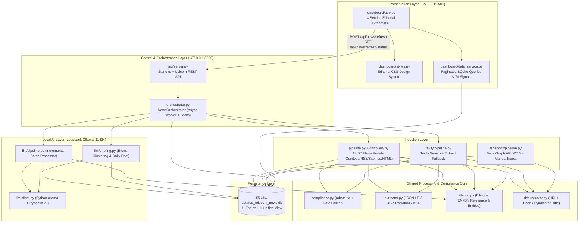

# System Architecture — Bangladesh Telecom Intelligence

This document describes the **actual implemented architecture** of `bd_telecom_scraper/` as built and verified locally on an 8 GB MacBook Air M1.

---

## 1. Architectural Layers

---

## 2. Design Principles Implemented in Code

1. **Additive Modularity Around a Shared SQLite Store:** Every capability (Tavily, Facebook, Ollama LLM, Daily Brief, Orchestrator) adds its own dedicated tables linked cleanly to `articles.id` without altering or duplicating raw scraped articles.
2. **Compliance-First Collection:** `PoliteHttpClient` ([compliance.py](../bd_telecom_scraper/compliance.py)) caches `/robots.txt` per domain, enforces per-domain rate limits (`1.0–2.0s`), and treats `HTTP 403` (Cloudflare/WAF) as a non-bypassable `RESTRICTED` state.
3. **Zero-Cloud Local Inference:** `LLMConfig.validate_loopback()` ([llm/config.py](../bd_telecom_scraper/llm/config.py)) rejects any `OLLAMA_BASE_URL` host outside `{localhost, 127.0.0.1, ::1}`.
4. **Decoupled Async Execution:** The Streamlit dashboard never executes shell commands or blocks UI threads on long scrapes/LLM batches. Instead, clicking **Fetch Latest News** posts to the local Starlette API (`POST /api/news/refresh`), which spawns a locked background worker thread and persists stage transitions to SQLite (`refresh_jobs`). Browser reloads safely re-attach to live status via `GET /api/news/refresh/status`.
5. **Hardware-Conscious Execution (8 GB RAM):** Live benchmarking (`qwen2.5:3b` vs. `gemma3:1b` on 6 Bangla + English articles) established `qwen2.5:3b` (`~1.9 GB` weights, `~1.5 GB` active RAM delta, `~21–27 s/article` on Apple M1) as the default model—outperforming `gemma3:1b` on Bangla translation, exact figure preservation, and zero operator hallucination—paired with a 25-article per-click batch cap to prevent runaway memory/thermal load.

---

## 3. SQLite Database Schema (`data/bd_telecom_news.db`)

The platform initializes **11 tables and 1 SQL view** automatically on first run (no external database server required):

| Table / View | Owner Module | Role |
| :--- | :--- | :--- |
| `articles` | `storage.py` | Immutable scraped articles (`canonical_url UNIQUE`, original `headline`, `language`, `content`, `published_at`, `content_hash`, lexical tags). |
| `scrape_runs` | `storage.py` | Audit history of portal scraper executions (`run_id`, counts, per-source health JSON). |
| `article_ai_analysis` | `llm/repository.py` | 1:1 FK (`article_id → articles.id`) storing `PENDING`/`PROCESSING`/`COMPLETED`/`FAILED` status, English headline, summary, takeaways, category, entities, operators, sentiment, impact, reported facts, AI implications, `model_name`, `prompt_version`, `source_content_hash`, retry count, error log. |
| `daily_briefings` | `llm/repository.py` | Cached executive Daily Briefs keyed by `briefing_date` and guarded by `source_fingerprint`. |
| `llm_job_locks` | `llm/repository.py` | Single-runner PID/timestamp concurrency lock (`article_analysis`, `daily_briefing`, `news_refresh`). |
| `refresh_jobs` | `orchestrator.py` | Live per-stage status (`stages_json`) and aggregated counters (`metrics_json`) for one-click refresh monitoring. |
| `tavily_usage_log` | `tavily/usage.py` | Monthly credit ledger (`endpoint`, `credits_used`, `new_articles_saved`, `status`). |
| `tavily_query_state` | `tavily/usage.py` | Per-query `last_run_at` timestamps enforcing `TAVILY_MIN_INTERVAL_HOURS`. |
| `facebook_sources` | `facebook/storage.py` | 24 target Facebook Pages with identity verification status, evidence notes, and `access_mode`. |
| `facebook_posts` | `facebook/storage.py` | Collected Facebook posts distinguishing `graph_api_managed`, `graph_api_ppca`, and `manual_submission`. |
| `facebook_sync_state` | `facebook/storage.py` | Incremental sync watermarks (`last_post_published_at`) per Facebook Page. |
| `unified_telecom_intel` *(VIEW)* | `facebook/storage.py` | Read-only `UNION ALL` combining `articles` (`channel='news_portal'`) and `facebook_posts` (`channel='facebook_page'`). |

For full module-by-module implementation details, see [TECHNICAL_DOCUMENTATION.md](TECHNICAL_DOCUMENTATION.md).
