# End-to-End Data Pipeline

This document traces how a news item moves from discovery to display in the editorial dashboard.

---

## Pipeline Flow Diagram

```mermaid
flowchart LR
    A["Stage 1: Portal Scraper<br/>18 BD Sources<br/>(Quintype / RSS / Sitemap / HTML)"] --> D["Canonicalize URL +<br/>Pre-DB Deduplication"]
    B["Stage 2: Tavily Search<br/>6 Semantic Queries<br/>(BD + Global Credible Domains)"] --> D

    D -->|"New URL"| E["Primary HTML Extractor<br/>(robots.txt + JSON-LD / Trafilatura / BS4)"]
    E -->|"Failed / < 120 chars<br/>(Tavily hits only)"| F["Tavily Extract Fallback<br/>(Batched 5 URLs = 1 credit)"]
    E -->|"OK"| G["Bilingual Telecom Filter<br/>& Entity Normalizer (EN + BN)"]
    F --> G

    G -->|"Score >= 2.0 &<br/>Not Syndicated Dup"| H[("SQLite: articles<br/>+ JSON/CSV Exports")]

    H -->|"New or Changed<br/>content_hash"| I["Stage 3: Local Ollama<br/>(qwen2.5:3b + Pydantic v2<br/>+ Entity Fusion)"]
    I --> J[("SQLite:<br/>article_ai_analysis")]

    J -->|"High/Medium Relevance"| K["Stage 4: Bangla-English<br/>Event Clustering &<br/>Daily Brief Synthesis"]
    K --> L[("SQLite:<br/>daily_briefings")]

    H & J & L --> M["Editorial Dashboard<br/>(4 Sections + 7d Signals)"]
```

---

## Stage-by-Stage Walkthrough

### Stage 1 — Compliant Bangladeshi News Portal Collection (`TelecomNewsScraper.run`)
1. Checks `/robots.txt` per domain via `PoliteHttpClient`; immediately marks `HTTP 403` WAF domains (`Kaler Kantho`, `Samakal`, `Jugantor`) as `RESTRICTED` without bypassing.
2. Discovers candidate URLs within the lookback window (`--days 14`) prioritizing Quintype Search/Collections JSON APIs → live section RSS feeds → targeted XML sitemaps (daily/monthly/half-year/`googlenews.xml`) → permitted section HTML.
3. Pre-filters large sitemap lists via `candidate_looks_promising()` (word-bounded EN + URL-decoded BN slug tokens) before fetching full pages.
4. Extracts headline, `Asia/Dhaka` timestamp, summary, and body text via `extract_article_from_html()`.
5. Applies `evaluate_relevance(threshold=2.0)` and `Deduplicator` (canonical URL, `content_hash`, and `>= 0.86` syndicated headline similarity).
6. Persists unique articles to SQLite `articles` and refreshes `data/bd_telecom_news.json` and `data/bd_telecom_news.csv`.

### Stage 2 — Tavily Search & Extract Fallback (`TavilyDiscoveryPipeline.run`)
1. Skips any query whose `last_run_at` in `tavily_query_state` is within `TAVILY_MIN_INTERVAL_HOURS` (`12h`).
2. Checks `TavilyUsageTracker.can_spend()` against `TAVILY_MONTHLY_CREDIT_BUDGET` (`800` credits/month default).
3. Runs `POST /search` (`topic="news"`, `search_depth="basic"`) restricted by `include_domains`.
4. Immediately skips URLs/titles already in `articles` (**zero extra HTTP calls or extract credits**).
5. Attempts free primary HTML extraction first; batches only failed/short URLs into `POST /extract` (5 URLs = 1 credit).
6. Filters, deduplicates, logs credit usage to `tavily_usage_log`, and saves to `articles` (`discovery_method = 'tavily_search'` or `'tavily_extract'`).

### Stage 3 — Local Ollama LLM Analysis (`ArticleIntelligencePipeline.process_batch`)
1. Acquires SQLite `llm_job_locks` (`article_analysis`).
2. Queries `get_eligible_articles()` — selecting only unanalyzed, `PENDING`, changed-`content_hash`, or retryable `FAILED` articles (never reprocesses unchanged completed articles).
3. Sends up to `6,000` characters to local Ollama (`qwen2.5:3b`) with Pydantic JSON-schema enforcement (`ArticleIntelligence`).
4. Fuses deterministic bilingual `extract_entities()` matches into `organizations` and `operators_mentioned`.
5. Isolates per-article errors (`FAILED` with `retry_count` increment) and persists validated records into `article_ai_analysis`.

### Stage 4 — Bangla–English Clustering & Daily Brief (`DailyBriefingEngine.generate_briefing`)
1. Fetches `COMPLETED` articles (`High`/`Medium` relevance) for the current date (expanding to a rolling 7-day window if `< 2` articles exist on the exact date).
2. Computes `source_fingerprint` from sorted article IDs + model + prompt version; reuses the cached briefing if unchanged.
3. Groups multi-outlet coverage of the same event via `cluster_related_articles()` (ranked by impact, relevance, and corroboration; capped at 5 clusters).
4. Generates `DailyBriefingOutput`, sanitizes every `supporting_article_ids` list against actual database IDs, and stores the result in `daily_briefings`.

### Stage 5 — Editorial Dashboard Refresh (`DashboardDataService` + `app.py`)
1. While `NewsOrchestrator` executes Stages 1–4 in a background thread, the Streamlit `@st.fragment(run_every=2)` strip polls `GET /api/news/refresh/status`.
2. On completion, the dashboard clears `st.cache_data` and re-queries SQLite for The Daily Brief, Lead Story, filtered Intelligence Feed, and 7-day vs. prior-7-day Industry Signals.

### Parallel Channel — Facebook Page Ingestion (`FacebookIntelPipeline`)
Runs independently via CLI (`python -m bd_telecom_scraper.facebook`):
- **Graph API `v27.0` (`sync`):** For Pages managed by the user or with approved PPCA, synced incrementally via `facebook_sync_state`.
- **Manual Ingestion (`ingest-manual` / `ingest-batch`):** Validates public post URLs + pasted text, runs shared bilingual filtering, tags `collection_method = 'manual_submission'`, leaves unavailable metrics as `NULL`, and exposes records alongside news articles via `unified_telecom_intel`.
